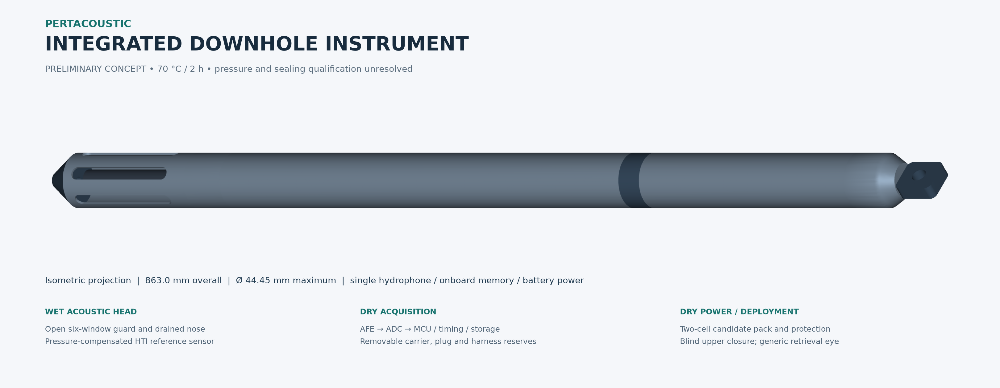
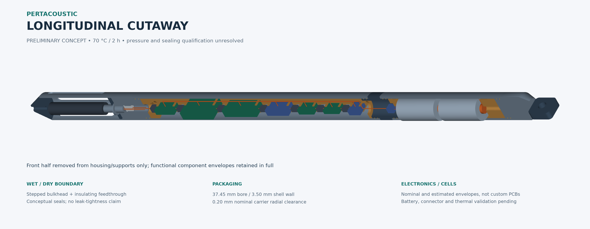
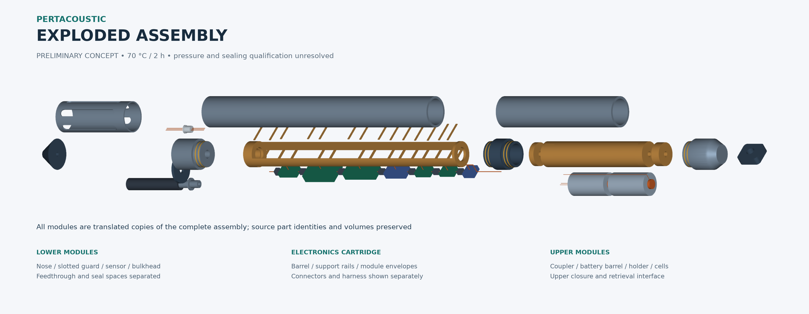

# PertAcoustic — 3D Engineering Workstream

PertAcoustic is the broader PHE–UGM research project studying downhole acoustic measurements for identifying fluid movement and possible flow locations. This repository contains its 3D engineering design workstream, including a proposed integrated downhole instrument concept and earlier casing/thermal studies.

**Current CAD concept: 863 mm long × 44.45 mm maximum OD.** This is one conceptual engineering output within the project. It represents a protected hydrophone, onboard acquisition, battery power and memory storage; it has no separately approved product name and is not an approved PHE field instrument.

[Engineering report](results/integrated-downhole/design_report.md) · [STEP deliverables](#available-deliverables) · [CCL integration assessment](docs/ccl-integration-assessment.md)

## PertAcoustic project context

The official study title is **“Studi Identifikasi Aliran Fluida di Lubang Sumur Menggunakan Sistem Pertacoustic (Spectral Noise Logging) untuk Mengatasi Permasalahan Air”**.

- **Project Owner:** Pertamina Hulu Energi Upstream Innovation.
- **Executing institution:** Laboratorium Geofisika, Departemen Fisika, FMIPA, Universitas Gadjah Mada.
- **Study period:** May 2026 – January 2027.

The study has three main objectives:

1. **Characterization and design parameters:** investigate industry requirements, acoustic sensing, sensor specifications, frequency response, sensitivity, data acquisition, memory and power management.
2. **Downhole components and housing design:** study and design mechanical, pressure and thermal protection for downhole hydrophones, associated electronics and batteries.
3. **Analytical software development:** develop FFT, cross-correlation and noise-filtering methods, alongside monitoring/visualization software for interpreting fluid movement and possible flow locations.

This project identity and framing follow the human-supplied account of the August 2026 official progress presentation. That presentation was not independently inspected for this correction and is not republished here. The official title's “Sistem Pertacoustic” wording does not establish a formal name or approval for the conceptual CAD assembly.

## Scope of this repository

`pertacoustic-3d-design` concerns conceptual downhole instrument architecture, pressure/thermal housing studies, component packaging, mechanical interfaces, CAD/STEP geometry, related engineering calculations and screening, design visualization and technical evidence. Earlier research artifacts and experimental engineering studies remain as historical provenance.

Laboratory experiments, acoustic characterization, physical hardware acquisition and analytical software are related project workstreams. This repository does not contain the entire project's hardware, signal-processing pipeline or monitoring dashboard. Its CAD visualization and engineering calculations support the 3D workstream; they do not establish implementation of the project's analytical software objective.

## Current engineering work

The team's current **TRL 4-related experimental workstream** involves laboratory testing with hydrophones, acquisition systems, controlled acoustic measurements and simulated leakage conditions. Laboratory pumps, piping and leak chambers are outside this CAD model.

The **conceptual 3D engineering work** develops an idealized integrated downhole architecture for future prototype development and relevant-environment validation. It supports planning toward TRL 5, independently of the current laboratory configuration. The model does not establish that the instrument or project has achieved TRL 5, and TRL 5 planning does not define the entire project's scope.

- **Design maturity:** Conceptual Engineering Design / Preliminary Integrated System Design.
- **Geometry baseline:** the integrated implementation at `d9f69e81ff0882f17f9fa2425ef3df79d5d00f9d`, with final-source verification evidence added at `c91c20c83a26d8d61e5e23b99a1fce28cad27c19`.
- **Recorded verification:** 81 regression tests passed on the exact final source; all eight STEP exports were reimported and checked. See the [remediation results](results/integrated-downhole/validation/review-remediation/remediation-results.json) and [complete test log](results/integrated-downhole/validation/review-remediation/unittest-final-source.log).
- **CCL status:** external-module and separate-system alternatives are being assessed. No CCL sensor or connector has been added to the instrument.
- **Qualification:** pressure, sealing, actual hardware fit, battery runtime, complete-instrument thermal behavior and acoustic calibration remain unresolved. Local CAD checks are not physical qualification or CI.

## Engineering requirements

The table records the previously human-adopted environmental and geometric constraints for this engineering workstream. The original PHE/MoM documents were not independently inspected for this correction; these entries do not assert fresh verification of official requirements. Current CAD choices, component reservations and screening cases remain preliminary design assumptions.

| Parameter | Governing envelope | Current interpretation |
|---|---|---|
| External operating temperature | 70 °C | Validation boundary, not a verified electronics/battery temperature |
| Exposure duration | 2 hours / 7,200 s | Conservative operating scenario |
| Preferred instrument OD | 44.45 mm / 1.75 in | Current modeled maximum OD |
| Maximum instrument OD | 57.15 mm / 2.25 in | Whole-toolstring applicability requires PHE confirmation |
| Maximum instrument length | 2,000 mm | Whether this includes an attached CCL/toolstring is unresolved |
| Representative depth | Approximately 1,000 m | Context only; not a pressure rating |
| Authoritative design pressure | Unresolved | 10, 20 and approximately 68.95 MPa are screening cases only |

## Conceptual instrument architecture

| Section | Conceptual function |
|---|---|
| Wet sensor head | One HTI-02-DHPC/D reference hydrophone behind an open protective guard; drained lower nose |
| Sensor mount and bulkhead | Provisional retention, conceptual seal spaces and insulating feedthrough separating wet and dry regions |
| Dry acquisition cartridge | AFE, PCM1808 reference ADC, STM32F411 reference MCU, timing, storage, regulation and protection envelopes |
| Battery cartridge | Two candidate cells in series, holder, removable end supports, contacts and disconnect reservation |
| Pressure housing | Two Inconel 718 candidate barrels and a dry service coupling; pressure rating remains unresolved |
| Upper interface | Blind closure and generic deployment/retrieval eye, without a finalized wireline connection or load rating |

The hydrophone senses surrounding pressure fluctuations through the open guard. Formation fluid is not intended to enter the dry electronics compartment. No additional flow-control valve is included. Supplier-controlled interfaces, pinout, retention and production seals remain provisional.

## Current CAD baseline

| Quantity | Nominal model value |
|---|---:|
| Overall length | 863.0 mm |
| Maximum OD | 44.45 mm |
| Preliminary shell wall | 3.50 mm |
| Shell bore | 37.45 mm |
| Named parts / valid solids | 36 / 81 |
| Prohibited nominal interference | 0.0 mm³, using a 1e-4 mm³ reporting threshold |

The electronics reservations use nominal or estimated module dimensions, not measured assemblies or finalized custom PCBs. PA66-GF30 remains a prototype carrier candidate, PEEK the benchmark and PPA a secondary option. The baseline has no aerogel. The nominal 34.93 mm ADC clearance envelope and approximately 2.52 mm diametral margin do not establish physical assembly fit.

## Visual gallery

### Complete isometric assembly



### Longitudinal cutaway



### Exploded assembly



Additional views: [annotated wet/dry section](results/integrated-downhole/figures/annotated_longitudinal_section.png), [orthographic views](results/integrated-downhole/figures/integrated_orthographic.png), and [integration details](results/integrated-downhole/figures/integration_details.png). The cutaway and exploded geometry derive from the complete parametric assembly.

## Repository structure

```text
cosmo/
  integrated_downhole.py     Integrated CAD, geometry checks, STEP export/reimport and views
  integrated_report.py       Engineering summary generated from model evidence
  compact_casing.py          Earlier compact-casing packaging/material/thermal screens
  biweekly5.py               Historical Biweekly 5 CAD/CAE workflow
  core/                     Reusable legacy CAD, mesh, solver and result utilities
  material_library.json     Material data and provenance
tests/                      Integrated, compact-casing and historical regression checks
results/
  integrated-downhole/      Current STEP, figures, parameters, report and validation evidence
  compact-casing/           Preserved compact-casing study
  biweekly-5/               Preserved historical Biweekly 5 evidence
  hti-02-dhpc-d-20260716/    Historical invalid thermal run; not current performance evidence
docs/
  ccl-integration-assessment.md  CCL alternatives, timing/depth interfaces and PHE questions
.agents/                    Delivery governance and supporting repository context
```

## Setup and reproduction

Run from the repository root. The observed working environment is **Python 3.11.16**, CadQuery 2.8.0, NumPy 2.4.6, Matplotlib 3.11.1, VTK 9.6.2 and Gmsh 4.15.2. These are tested versions, not declared minimum versions. [pyproject.toml](pyproject.toml) lists unpinned dependencies and does not declare a Python compatibility range or provide a lockfile.

For a fresh checkout, the conventional editable setup is:

```bash
python3.11 -m venv .venv
source .venv/bin/activate
python -m pip install -e .
```

The editable install keeps repository data files available at their source paths. Fresh dependency installation was not rerun for this documentation update. On Windows, activate the environment with `.venv\Scripts\Activate.ps1` in PowerShell instead. Platform-specific native dependencies and graphics support may need environment setup.

Generate the complete CAD, figures, report and eight STEP files into a separate output directory:

```bash
python -m cosmo.integrated_downhole --output /tmp/pertacoustic-reproduction
```

The generator automatically checks geometry and reimports each STEP to check solid validity, coverage, millimetre units, volume and bounds. For geometry and STEP generation without rendered images:

```bash
python -m cosmo.integrated_downhole --parameters results/integrated-downhole/parameters.json --output /tmp/pertacoustic-geometry-check --no-figures
```

A geometry check without writing CAD outputs is also available:

```bash
python -c 'from cosmo.integrated_downhole import build_design, verify_design; print(verify_design(build_design())["status"])'
```

Run all regression tests with:

```bash
python -m unittest discover -s tests -v
```

Use a writable path appropriate to the host in place of `/tmp` when needed. The generator's default output is `results/integrated-downhole/`; the examples above keep the committed baseline intact. Rendered figures require VTK and a working offscreen graphics backend. The integrated workflow does not require a CalculiX run. The legacy optimization/Biweekly 5 workflows write their own result directories and are not part of these reproduction commands.

## Available deliverables

| Deliverable | Repository file |
|---|---|
| Native parametric CAD | [integrated_downhole.py](cosmo/integrated_downhole.py) |
| Parameters | [parameters.json](results/integrated-downhole/parameters.json) |
| Complete assembly STEP | [integrated_complete.step](results/integrated-downhole/cad/integrated_complete.step) |
| Sectional STEP | [integrated_sectional.step](results/integrated-downhole/cad/integrated_sectional.step) |
| Exploded STEP | [integrated_exploded.step](results/integrated-downhole/cad/integrated_exploded.step) |
| Wet head | [module_wet_head.step](results/integrated-downhole/cad/module_wet_head.step) |
| Sensor bulkhead | [module_sensor_bulkhead.step](results/integrated-downhole/cad/module_sensor_bulkhead.step) |
| Electronics cartridge | [module_electronics_cartridge.step](results/integrated-downhole/cad/module_electronics_cartridge.step) |
| Battery pack | [module_battery_pack.step](results/integrated-downhole/cad/module_battery_pack.step) |
| Pressure housing | [module_pressure_housing.step](results/integrated-downhole/cad/module_pressure_housing.step) |
| Engineering summary | [design_report.md](results/integrated-downhole/design_report.md) |
| Geometry/export evidence | [verification.json](results/integrated-downhole/verification.json) |
| Artifact hashes | [artifact_manifest.json](results/integrated-downhole/artifact_manifest.json) |

## CCL and depth correlation

A Casing Collar Locator (CCL) detects changes associated with casing/tubing joints and supports depth correlation against known features. It is possible external logging/depth-correlation infrastructure relevant to the project: an **external reference module or a separately operated PHE measurement system**. No CCL sensor is included in the current CAD concept. The [assessment](docs/ccl-integration-assessment.md) compares:

- **A — Combined toolstring:** a separate CCL mechanically connected to the acoustic module, subject to verified dimensions, connections, deployment conditions, sensor offsets and any power/data interfaces.
- **B — Separate measurement systems:** PHE supplies appropriate time–depth/reference data while the proposed acoustic logging module records timestamped acoustics. Clock alignment, drift, timestamp meaning, depth datum and the measurement-point relationship must be established. Different physical runs cannot be correlated by timestamp plus a fixed offset alone.

The 11 November 2026 meeting notes mention approximately **0.7 m for a CCL** and **1.0 m / 1.5 m ALFA segments** in different diagrams. These are unconfirmed observations, not supplier specifications or one mandatory combined assembly. ALFA is not a required component of the proposed acoustic logging module.

Using only the unconfirmed 700 mm CCL length, `863 + 700 = 1,563 mm` before net connection and other toolstring allowances. This is a planning calculation, not a verified assembly or a finding that a combined string meets the 2 m limit.

PHE decisions remain open: connected module versus independent system; whether the 2 m limit applies to the instrument or whole string; exact CCL model/OD/length/measurement point; connector and deployment interfaces; available time–depth records and datums; and the hydrophone-to-CCL reference offset. Neither alternative is selected as final.

The [CCL documentation verification record](results/integrated-downhole/validation/ccl-readme-checks.json) records the earlier link/reproduction checks. The [project-framing correction record](results/integrated-downhole/validation/project-framing-checks.json) records the subsequent documentation checks and byte preservation; it does not claim new engineering tests.

## Engineering limitations

Design pressure and fluid/corrosion conditions are unresolved. Threads, seals, feedthrough retention, lifting loads and supplier interfaces are conceptual. Battery selection and hot runtime, component temperatures over two hours, conditioned carrier fit and actual PCB/harness clearances need physical validation. Guarded acoustic response and system calibration are not established. CCL interoperability also requires PHE interface and reference-data confirmation.

CAD validity, analytical pressure screens and a shell thermal lower bound do not qualify the assembled instrument. Procurement, manufacturing release, pressure certification and field deployment are outside the current result.

Generated reports, figure labels and historical artifacts retain their original wording for traceability. Where those artifacts use PertAcoustic as shorthand for an instrument concept, read that label in the project/workstream context defined above; it is not evidence of a formally named or approved product. Their source, geometry and evidence have not been altered by this documentation correction.

## References

- **Project identity and objectives:** human-supplied account of the August 2026 official progress presentation, reproduced in the project context above; no restricted presentation file is published. The project study period is not a claim of an approved field-deployment schedule.
- [HTI — HTI-02-DHPC/D](https://www.hightechincusa.com/products/hydrophones/hti02dhpc.html): public sensor reference; exact purchased interface remains provisional.
- [Baker Hughes — Sondex CCL201 specification](https://dam.bakerhughes.com/m/1a4960ecd80f51df/original/Sondex-casing-collar-locator-CCL-spec.pdf): CCL principle and model-specific dimensions/measure point.
- [Welltec — Casing Collar Locator](https://www.welltec.com/products-services/intervention/casing-collar-locator-ccl): configuration-dependent CCL envelopes.
- [Weatherford — Geothermal Depth Logger and Encoder](https://www.weatherford.com/drilling-and-evaluation/wireline-products/telemetry-systems/geothermal-depth-logger-and-encoder/): time-recorded depth and subsequent merging with tool data.
- [Weatherford — Memory Logging Tool](https://www.weatherford.com/drilling-and-evaluation/wireline-products/cased-hole-formation-evaluation/memory-logging-tool/): an example of vendor-specific modular memory logging.

Public references were consulted for the preceding CCL assessment on 11 November 2026. Manufacturer product ratings do not establish project requirements or qualify the conceptual instrument. See the [engineering report](results/integrated-downhole/design_report.md) and [CCL assessment](docs/ccl-integration-assessment.md) for claim-specific context and limitations.
