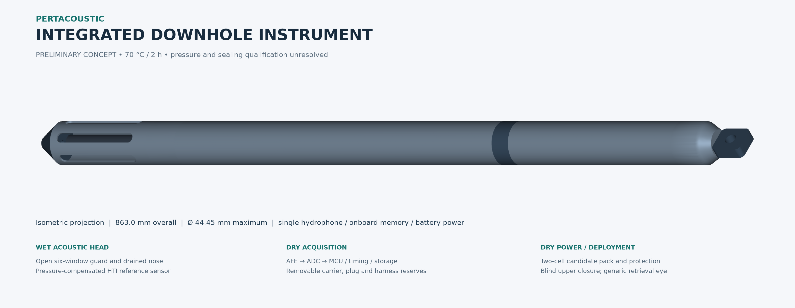
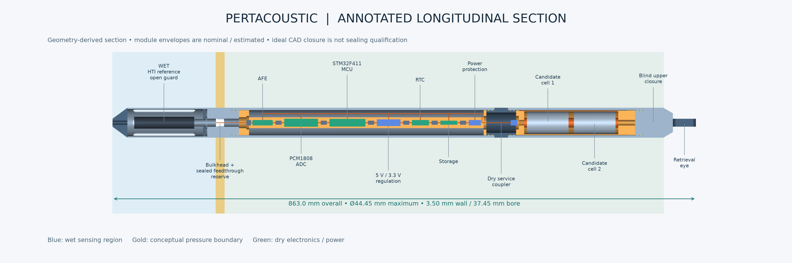
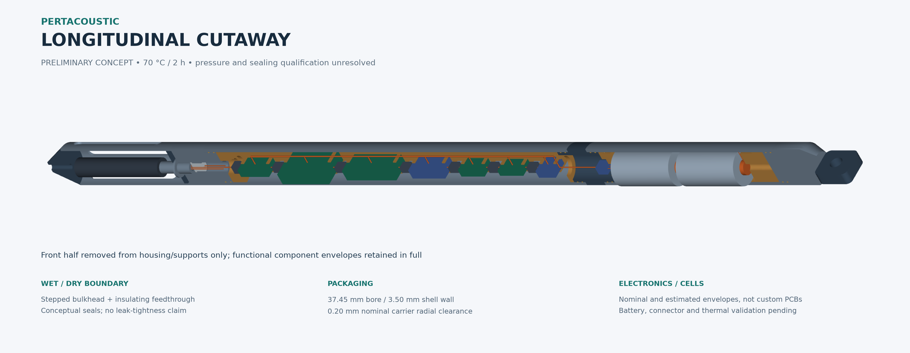
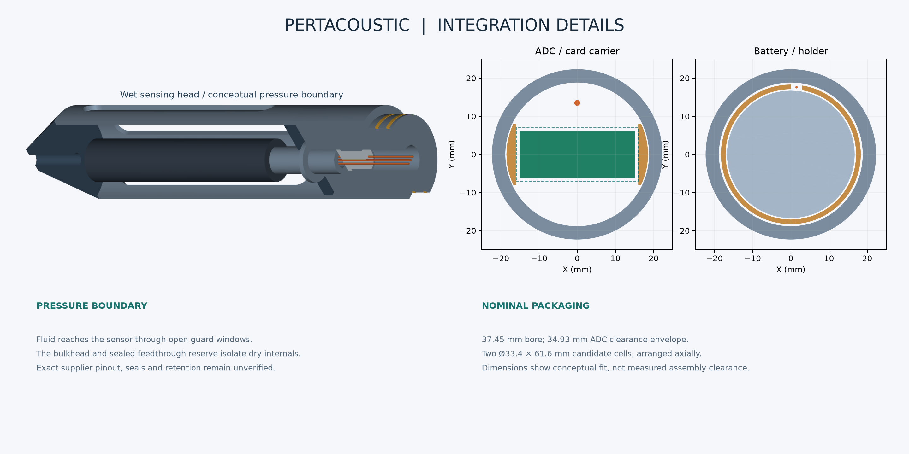
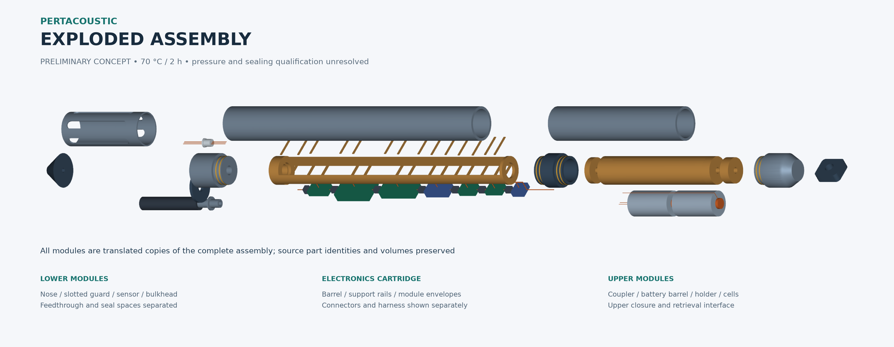

# PertAcoustic — Integrated Downhole Conceptual Design

**Maturity:** Conceptual Engineering Design / Preliminary Integrated System Design  
**Outcome:** Review Required — independent Planner/Reviewer acceptance pending  
**Engineering envelope:** 70 °C external / 7200 s exposure  
**Scope:** A proposed integrated memory instrument for the next TRL 5 development phase; TRL 5 achievement is not claimed.

This invocation generated 6 visualization images. A geometry-only run does not claim image generation or visual inspection.

## 1. Design intent and selected architecture

The concept integrates a single hydrophone, onboard acquisition/storage and a two-cell candidate battery pack inside a slender, serviceable downhole instrument. It extends the compact-casing study into a complete instrument; laboratory piping, pumps, leak chambers and externally connected test equipment are excluded.

The complete modeled envelope is **863.0 mm long × 44.45 mm maximum OD**. Two pressure-barrel sections share the inherited **3.50 mm wall / 37.45 mm bore**. These dimensions satisfy the human-adopted preferred OD and maximum length; they do not establish a pressure rating. Approximately 1,000 m remains deployment context, not design-pressure authority. Original PHE/MoM documents were not independently inspected in this run; the supplied human envelope controls this conceptual study.

| Human-adopted constraint | Governing value | Modeled / assessed value |
|---|---:|---:|
| Preferred / maximum OD | 44.45 / 57.15 mm | 44.45 mm maximum |
| Maximum overall length | 2,000 mm | 863.0 mm |
| External temperature / exposure | 70 °C / 7,200 s | Retained as validation envelope; temperatures not qualified |



The [public HTI reference](https://www.hightechincusa.com/products/hydrophones/hti02dhpc.html) describes a pressure-compensated hydrophone with a nominal 3.5 in × 0.688 in envelope. The [Sondex NTO specification](https://dam.bakerhughes.com/m/51dd2829b101fada/original/Sondex-noise-tool-spec.pdf) provides an industrial comparison for downhole hydrophone digitization with memory or surface readout. These support the architecture comparison, rather than transferring another manufacturer's rating to PertAcoustic.

| Acoustic architecture | Assessment |
|---|---|
| Protected pressure-compensated sensor, no added valve | Selected conceptual option. Open cage windows expose the sensing envelope to surrounding fluid pressure fluctuations; the dry boundary is behind the sensor. |
| Separate fluid-coupled/compensated chamber | Retained as a contingency if the selected supplier interface requires it. Coupling medium, membrane and expansion behavior would require separate justification. |
| Valve-assisted compensation | Not selected: no specific flow-control, fill/bleed or pressure-compensation function has been demonstrated that requires an extra valve. |

This selection is an engineering inference from the sensor's documented compensation and the requested integration scope. The sensor's internal compensation mechanism is not invented or modeled.

## 2. Physical arrangement and material candidates

From the lower tip upward: drained nose; six-window guard; HTI envelope and provisional mount flange/split retainer; stepped bulkhead/feedthrough; electronics barrel and removable cartridge; dry service coupler; battery barrel and cartridge; blind upper closure; generic retrieval eye. The upper interface is a geometric retention/deployment reservation, without a finalized wireline standard or rated lifting load. Surface servicing requires opening the dry instrument after retrieval; no external electrical feedthrough or final USB connector is assumed.

The shell/bulkhead candidate is Inconel 718. PA66-GF30 remains the prototype carrier candidate, PEEK the material benchmark and a candidate for the battery holder, and PPA a secondary carrier option. Internal polymers are supports, not pressure boundaries. Dry placement reduces direct fluid exposure but does not eliminate conditioning, creep or thermal-expansion validation. Seal compounds, conductor insulation and hermetic feedthrough materials remain unselected. No aerogel, active cooling or added compensation chamber is introduced.

| Electronics block | Axial Z (mm) | Envelope L × W × H (mm) | Dimension status |
|---|---:|---|---|
| Analog front-end | 207.0–237.0 | 30 × 16 × 8 | Inherited nominal, unmeasured |
| PCM1808 reference ADC | 254.0–304.0 | 50 × 30 × 12 | Inherited nominal, unmeasured |
| STM32F411 reference MCU | 321.0–374.0 | 53 × 21 × 11.5 | Inherited nominal, unmeasured |
| 5 V / 3.3 V regulation | 391.0–426.0 | 35 × 18 × 10 | Inherited nominal, unmeasured |
| RTC / timing module | 443.0–468.0 | 25 × 15 × 8 | Inherited nominal, unmeasured |
| Nonvolatile storage module | 485.0–510.0 | 25 × 15 × 6 | Inherited nominal, unmeasured |
| Power protection reservation | 527.0–545.0 | 18 × 18 × 8 | Estimated |

These boxes reserve the inherited laboratory-module envelopes and an estimated protection module. They are not measured boards or finalized custom PCBs. No MCU/ADC substitution was made. The AFE/ADC are placed near the sensor; timing, storage, regulation and protection follow axially. Intermodule gaps reserve connector bodies and 4 mm on each end; the upper corridor reserves a routed harness. Exact harness bend radii, header protrusions, electromagnetic coupling and board mounting holes still need hardware measurements.

The battery cartridge reserves two **Ø33.4 × 61.6 mm** cells in series, an 8 mm intercell contact region, separate contacts/leads, a disconnect, insulation, an open sleeve, removable end supports and axial spacers. The [Saft LSH 20 manufacturer data](https://saft4u.saft.com/en/download_file/8bdd6f76-c9c5-422e-95bd-a18e0a12d80f/English) is a candidate reference, not a qualified pack selection. Public manufacturer search extracts identify a +85 °C upper operating limit and high-current capability; direct PDF retrieval returned 502 during this run. The 61.6 mm CAD length is a conservative reservation pending exact version and termination verification. Neither nominal capacity nor a chip temperature limit proves two-hour battery operation at 70 °C.

## 3. Wet section, pressure boundary and acoustic coupling



The guard and nose are wet and permanently open. Six axial windows give direct radial fluid access to the sensing envelope, and the nose has an open drain rather than a valve. A generic mount flange and split retainer show how sensor retention can be captured by the removable upper guard. Their dimensions and fastening are conceptual, not supplier-approved interface details.

The transition at **Z = 153–165 mm** is a stepped metallic bulkhead with an insulating three-pin feedthrough reservation. Three conductors illustrate routing, not a verified HTI pinout. Conceptual seal spaces are shown at the barrel closures and service coupling. The feedthrough shoulder, retention lands and mating surfaces identify the intended pressure boundary without claiming a production seal system. The upper closure is blind.

The nominal CAD coverage check finds **0.000000 mm³** uncovered volume in a 0.5 mm slice at Z = 160 mm. This proves only ideal geometric closure at that slice. It does not prove hermetic joints, leak-tightness, seal extrusion resistance or pressure retention. Surrounding fluid need not flow into the electronics volume for the hydrophone to sense pressure fluctuations.

All six designed radial window paths are geometrically unobstructed at the sensor midplane. Guard scattering, cavity/slot resonances, structural vibration, cable noise, flow noise and mounting sensitivity remain uncalibrated. [IEC 60565-1](https://webstore.iec.ch/en/publication/32074) and [IEC 60565-2](https://webstore.iec.ch/en/publication/33276) provide scope references for later bare-hydrophone comparison/calibration method selection; only their public summaries were consulted. They do not establish calibration or qualification of this complete digital/downhole instrument.

## 4. Packaging, geometry and assembly evidence



There are **36 named parts / 81 valid solids**; some named functional assemblies contain separate keepers, supports or conductors. The model evaluates **630 unordered part pairs**, of which **100** require exact Boolean intersections after disjoint bounding-box pruning. Maximum prohibited intersection is **0.000000 mm³**, with **no collision whitelist**. The tolerance is 0.0001 mm³. Intended face contacts are allowed; positive-volume overlaps are rejected. Every part is contained within the full nominal cylindrical OD envelope.

| Nominal clearance / allowance | Value (mm) | Interpretation |
|---|---:|---|
| ADC circular reservation including 1 mm each side | 34.928 | Derived from 30 × 12 mm nominal cross-section |
| Bore minus reserved ADC diameter | 2.522 | Diametral screening margin, not measured assembly clearance |
| Carrier to bore | 0.200 radial | Nominal, before manufacturing/conditioning effects |
| Battery holder to bore | 0.425 radial | Nominal sliding-fit reservation |
| Cell to holder | 0.400 radial | Nominal before sleeves, termination and pack validation |
| Sensor to guard at solid struts | 11.487 radial | Not an acoustic-response guarantee |



Logical assembly sequence:

1. Load the electronics envelopes radially onto the open lower saddles, then fit the separate top keepers and connectors. This avoids pretending that different-size boards can slide through permanently closed bridges. Attach the sensor pigtail, inspect routing and slide the cartridge axially into the electronics barrel against its spacer. Keeper fastening and strain relief remain detailed-design work.
2. Load cells and isolated contacts axially into the open battery sleeve before fitting its removable end supports. Route the positive lead through the dedicated groove/channel. Fit axial spacers and insert the cartridge into its barrel. Separate conductive solids indicate separate conductors; no battery circuit or protection qualification is claimed.
3. Connect the dry disconnect through the coupler bore, close the housing interfaces, and fit the blind upper closure. Closure torque, threads, anti-rotation, seal installation and load capacity need later design approval.
4. Assemble the sensor/mount, split retainer and guard at the wet bulkhead. Supplier interface, feedthrough and sealing details must be verified before any physical assembly.
5. Reverse the sequence after retrieval for battery replacement, memory access and inspection. Field opening, pressure testing or energized battery work was not performed.



The exploded model contains translated source parts, rather than independently drawn replacements. The cutaway removes the front half of housing/support/seal solids while retaining complete functional component envelopes. Both representations retain source identities. Exploded offsets are visualization/assembly aids rather than service-clearance or disassembly-load calculations.

## 5. Mechanical and thermal screening limits

The existing compact-casing analytical helpers were reused for the cylindrical barrel only:

| External pressure scenario (MPa) | Max von Mises (MPa) | Assumed-strength ratio | Elastic buckling factor |
|---:|---:|---:|---:|
| 10 | 59.69 | 16.75 | 11.33 |
| 20 | 119.39 | 8.38 | 5.67 |
| 68.95 | 411.57 | 2.43 | 1.64 |

These are screening scenarios, not an authoritative pressure requirement. The inherited strength value is a screening assumption dependent on product form and heat treatment. The long-cylinder buckling formula does not qualify joints, endcaps, local openings, feedthrough retention, imperfections, fatigue or sour service. No fresh structural FEA or complete-instrument pressure test was run.

The inherited 1 W load and an additional 2 W integration sensitivity use assumed 85% conversion efficiency and 7.2 V nominal series-pack voltage:

| Regulated load (W) | Nominal pack current (A) | Two-hour input energy (Wh) | All input treated as internal heat (W) | Ideal 70→85 °C lumped resistance budget (K/W) |
|---:|---:|---:|---:|---:|
| 1.0 | 0.163 | 2.353 | 1.176 | 12.750 |
| 2.0 | 0.327 | 4.706 | 2.353 | 6.375 |

These are transparent scenarios, not measured load, regulator performance, actual cell voltage under load, or verified runtime. Reserve, discharge derating and pulses must be assessed with the selected battery/firmware. Treating all input power as heat is a conservative system heat-load illustration, not a measured loss distribution.

**No complete-instrument two-hour thermal simulation is claimed.** External fluid convection, PCB/carrier contacts, enclosed gas, board/cell heat capacities, local losses and battery internal resistance are unknown. A 70 °C shell lower-bound result cannot be relabeled as PCB, junction or battery temperature. The resistance table is an ideal steady-state headroom illustration; it does not predict 7,200 s temperatures. The [PCM1808 datasheet](https://www.ti.com/lit/ds/symlink/pcm1808.pdf) supports 5 V analog / 3.3 V digital rails and an 85 °C operating-ambient upper limit; other selected modules and the complete pack still require exact-part thermal review.

For later validation, measure idle/acquisition/storage-write currents and hotspot losses; measure board-to-carrier and carrier-to-shell contact resistance; identify each component/cell limit; instrument shell, PCB, regulator and both cells; then expose the complete assembly to a controlled 70 °C bath/chamber for 7,200 s at measured duty cycles. Include startup, write pulses, conditioned carrier fit and removal checks. Establish a model from those measured paths before claiming thermal margin.

## 6. Acquisition and memory scenario

The reference ADC is stereo even though the concept uses one hydrophone. Conservatively storing both channels in 32-bit slots at 48 ksample/s requires 2.7648 GB over two hours; at 96 ksample/s, 5.5296 GB, or 6.08256 GB with 10% file/metadata allowance. A provisional ≥16 GB industrial storage target leaves nominal capacity room but does not select a particular card or prove sustained writes, filesystem behavior or temperature endurance. ADC maximum sample rate is not an end-to-end bandwidth guarantee. Anti-aliasing, preamp gain/mode, clocks, grounding, DMA, file handling and power-failure behavior need electrical/firmware validation; no firmware or PCB routing was implemented.

## 7. CAD exchange, reproduction and observed checks

| STEP exchange output | Reimported solids | Round trip |
|---|---:|---|
| [integrated_complete.step](cad/integrated_complete.step) | 81 | PASS |
| [integrated_sectional.step](cad/integrated_sectional.step) | 80 | PASS |
| [integrated_exploded.step](cad/integrated_exploded.step) | 81 | PASS |
| [module_wet_head.step](cad/module_wet_head.step) | 6 | PASS |
| [module_sensor_bulkhead.step](cad/module_sensor_bulkhead.step) | 7 | PASS |
| [module_electronics_cartridge.step](cad/module_electronics_cartridge.step) | 45 | PASS |
| [module_battery_pack.step](cad/module_battery_pack.step) | 12 | PASS |
| [module_pressure_housing.step](cad/module_pressure_housing.step) | 11 | PASS |

Every listed STEP is reimported, checked for valid positive-volume solids, module coverage, explicit millimetre units, volume agreement (relative tolerance 1e-7 / absolute 1e-3 mm³) and bounding-coordinate agreement (1e-4 mm). Part metadata, axial coordinates and exploded translations are in `verification.json`; file hashes are in `artifact_manifest.json`. The STEP outputs are part of the delivery, rather than relying on PNGs alone.

Use the repository's compatible environment with Python 3.11.16, CadQuery 2.8.0, NumPy 2.4.6, Matplotlib 3.11.1 and VTK 9.6.2 for rendered figures. No additional dependency was installed in this run. From the repository root:

```bash
python -m cosmo.integrated_downhole
python -m unittest discover -s tests -v
python -m cosmo.integrated_downhole --parameters results/integrated-downhole/parameters.json --output /tmp/pertacoustic-reproduction --no-figures
```

The default output is `results/integrated-downhole/`. `--parameters` accepts the published parameter fields; feasibility checks reject invalid envelopes. `--no-figures` still builds/verifies geometry and exports/reimports all STEP files. Historical Biweekly 5 and compact-casing output directories are explicitly rejected as generation targets. CalculiX/Gmsh are not required for this conceptual generation.

Exact regression commands/results, clean-directory regeneration, visual inspections and protected-file comparisons are recorded separately under `validation/`. Running the CAD generator does not itself run the regression suite. Local checks are not CI, and successful generation does not constitute engineering acceptance.

## 8. Remaining decisions and review status

| Item | Owner / closure needed | Current status |
|---|---|---|
| Authoritative design pressure, fluid and corrosion/sour environment | PHE / project technical authority before physical pressure-boundary design | Unresolved; no pressure rating |
| Exact hydrophone variant, pinout, thread datums, pressure compensation and mounting | HTI / technical authority before manufacture | Provisional interface geometry |
| Closure retention, glands, seal compounds and hermetic feedthrough | Mechanical/supplier review and pressure/leak tests | Conceptual reservations only |
| Actual PCB/header/connector/harness geometry | Electronics owner, physical measurements and fit trials | Nominal/estimated packaging |
| Battery termination, protection, duty-cycle/current and hot performance | Battery supplier/electrical owner before energized prototype | Candidate pack, unqualified |
| Carrier conditioning, fit, creep and thermal contacts | Materials/mechanical/thermal owners | Physical validation required |
| Guard/mount acoustic transfer and self-noise | Acoustic team, bare versus guarded comparison over selected band | Not calibrated |
| Deployment interface, shock, vibration and rated retrieval loads | Deployment/mechanical authority | Generic eye only |

Geometry, integrated module representation, parametric source, exchange files and local verification are ready for independent review. Visualization availability is recorded above for this invocation. Physical fit, supplier interfaces, pressure/sealing, corrosion, thermal behavior, runtime and acoustic performance remain conditional. Fabrication, procurement, field deployment, release and TRL 5 achievement are outside this result.

## Execution provenance

The implementation baseline is `667ccd59cf6657a75dfe3cc2b4c67488737ef028`. Actual execution began after the separately human-approved governance amendment at `3424b6d1f4d1fb6fad891760914d6d2c319ab3ca`, under `.agents/software-workflow.md` §15.8. The frozen human instruction sources and available content digests are recorded in `verification.json`; their complete messages/attachments remain part of the review context. No separate task Markdown was used or published. The rejected Draft/planning files are excluded from the deliverable. The immutable resulting implementation revision is supplied by the Git handoff, not self-embedded in generated content.

Historical source/results, dependency declarations, core engines and unrelated files are preserved. No supplier drawing, restricted PHE document or field data was copied into these outputs. Manufacturer references are public links and explicitly limited candidate facts. Independent Planner/Reviewer acceptance remains pending; this report does not approve its own implementation or authorize release.
